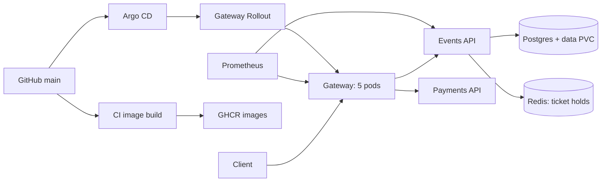

# QuickTicket SRE handbook

This is a short guide for the next person on call. Commands are for the `default` namespace unless they say otherwise. Keep a recent database dump before a risky change.

## Architecture

- The gateway handles public API calls. Events reads tickets from Postgres and keeps short holds in Redis. Payments is a mock payment service.
- The gateway has five pods and a canary Rollout. Events, payments, Redis, and Postgres each start with one pod. Postgres data should live on `postgres-data`; backup files live on a different PVC called `postgres-backups`.
- Redis holds are temporary. A Redis restart can lose holds. Postgres orders must survive a pod restart. A PVC helps with a pod restart, but a database dump is still needed for a bad write or a lost volume.

## How to deploy

1. Change code or a manifest on a branch. Run local checks and open a PR to `main`. Ask a teammate to review it.
2. After merge, the intended CI flow builds the images and writes their commit SHA tags into `k8s/`. Argo CD should watch `main` and apply these files. Check `kubectl -n argocd get applications quickticket` and `kubectl get pods,svc,rollouts`. On 12 October, the Argo CD Application was absent, so this GitOps step needs to be restored before a real release can use it.
3. For a gateway change, check `kubectl argo rollouts get rollout gateway --watch`. The canary starts at 20%. `gateway-error-rate` reads Prometheus and can stop a bad release. Check `kubectl get analysisruns` and `kubectl describe analysisrun <name>`.
4. If the new version fails, use `kubectl argo rollouts abort gateway`. Fix or revert the change in Git, then let Argo CD sync. A manual `kubectl edit` is temporary because Argo CD self-heals managed fields.

The local branch may be ahead of remote `main`. Check the actual CI run and Argo CD status before saying a GitOps deployment worked.

## What to monitor

| Question | Check |
|---|---|
| Are users seeing server errors? | Prometheus: `sum(rate(gateway_requests_total{status=~"5.."}[5m])) / sum(rate(gateway_requests_total[5m]))` |
| Are requests slow? | `histogram_quantile(0.99, sum by (le) (rate(gateway_request_duration_seconds_bucket[5m])))` |
| Is the error budget burning? | `gateway:error_budget_burn_rate:ratio_rate5m` |
| Did a canary fail? | `kubectl get analysisruns` and `kubectl argo rollouts get rollout gateway` |
| Are pods or volumes unhealthy? | `kubectl get pods,pvc; kubectl describe pod <name>; kubectl top pods` |

The golden-signals dashboard helps with errors, request rate, and latency. Also watch Redis readiness, DB connections, and backup age. A green `/health` response alone does not prove that reservations work.

## Incident response

1. Write down the start time and impact. Check `/events`, a reserve request, the 5xx ratio, and p99 latency. Keep one person focused on recovery and one on notes if help is available.
2. Check pods and recent changes: `kubectl get pods,rollouts,analysisruns`; `kubectl get events --sort-by=.lastTimestamp`. Read only the logs for the failing service first.
3. If a canary is causing errors, abort it. If Redis is down, restore its pod and test reserve again. If Postgres is empty, use the restore steps below. Do not keep retrying a write when the data state is unclear.
4. Confirm recovery with a user-facing request and the error/latency graphs. Record the end time, data loss, and what fixed the incident. Tell the course team or service owner when data may be lost or when recovery exceeds the agreed target.
5. Afterward, write a short timeline and one concrete prevention task. Lab 8 showed that `/health` did not reveal Redis failure; add a dependency check or a reserve-path alert.

## Backup and restore

Check `kubectl get cronjob postgres-backup` and `kubectl exec deployment/backup-inspector -- ls -lt /backups`. The CronJob makes a custom-format dump every five minutes and keeps five files. Check its last Job and log. A successful Job is useful evidence, but test a restore too.

For an urgent copy, run `kubectl exec <postgres-pod> -- pg_dump -U quickticket -Fc quickticket > quickticket.dump` in a shell that preserves binary output. On Windows PowerShell, use `cmd /c` redirection or copy a dump created inside the pod with `kubectl cp` so PowerShell does not change the bytes. Run `pg_restore --list` on the dump before relying on it.

To restore after data loss, stop the load generator, choose the newest valid dump, and copy it into the Postgres pod: `kubectl cp quickticket.dump <postgres-pod>:/tmp/backup.dump`. Then run `kubectl exec <postgres-pod> -- pg_restore -U quickticket -d quickticket --clean --if-exists /tmp/backup.dump`. Check `SELECT count(*) FROM events` and `SELECT count(*) FROM orders`, restart `deployment/events` if its DB connections are stale, and test `/events` and a reserve request. Note the dump time and the first good request time: these give the data-loss window and outage time. Keep the dump until the team checks the restored data.
